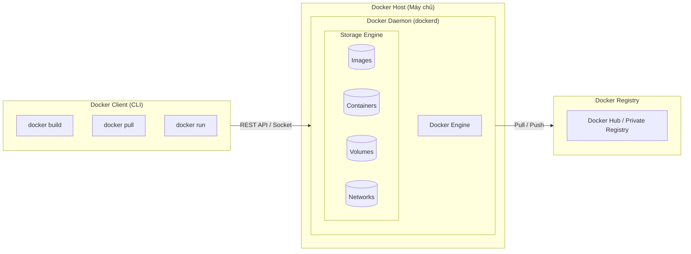
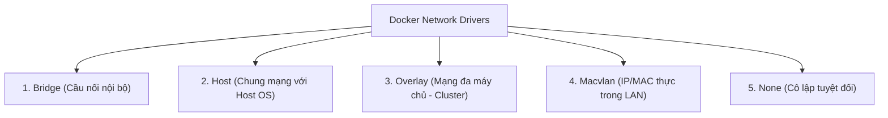

# HƯỚNG DẪN TOÀN DIỆN VỀ DOCKER: KIẾN TRÚC, NETWORK, RESOURCE LIMITS & MULTI-TENANT DEPLOYMENT

---

## MỤC LỤC
1. [Tổng Quan Về Docker & Bản Chất Container](#1-tổng-quan-về-docker--bản-chất-container)
2. [Các Thành Phần Cốt Lõi Trong Hệ Sinh Thái Docker](#2-các-thành-phần-cốt-lõi-trong-hệ-sinh-thái-docker)
3. [Mạng Trong Docker (Docker Networks)](#3-mạng-trong-docker-docker-networks)
4. [Quản Lý & Giới Hạn Tài Nguyên (Resource Limits: CPU & Memory)](#4-quản-lý--giới-hạn-tài-nguyên-resource-limits-cpu--memory)
5. [Mô Hình Chạy Nhiều Website Chung Một Server (Multi-Tenant Architecture)](#5-mô-hình-chạy-nhiều-website-chung-một-server-multi-tenant-architecture)
6. [Bảo Mật, Quản Lý Log & Tối Ưu Hệ Thống](#6-bảo-mật-quản-lý-log--tối-ưu-hệ-thống)

---

## 1. TỔNG QUAN VỀ DOCKER & BẢN CHẤT CONTAINER

### 1.1. Docker là gì?
**Docker** là một nền tảng mã nguồn mở cho phép lập trình viên tự động hóa việc đóng gói, phân phối và triển khai ứng dụng bên trong các môi trường cô lập gọi là **Container**. 

Triết lý cốt lõi của Docker: **"Build Once, Run Anywhere"** (Đóng gói một lần, chạy ở bất cứ đâu). Thay vì câu nói quen thuộc: *"Code chạy được trên máy tôi mà không chạy được trên server"*, Docker đóng gói toàn bộ: mã nguồn, thư viện (runtime), công cụ hệ thống, biến môi trường và cấu hình vào một khối thống nhất.

---

### 1.2. So sánh chuyên sâu: Container vs. Virtual Machine (Máy ảo VM)

| Tiêu chí | Máy ảo truyền thống (VM - VMware, VirtualBox) | Docker Container |
| :--- | :--- | :--- |
| **Kiến trúc** | Sử dụng **Hypervisor** (Type 1 hoặc Type 2) để ảo hóa phần cứng vật lý | Chạy trực tiếp trên **Host OS Kernel**, sử dụng chung nhân hệ điều hành |
| **Hệ điều hành khách** | Mỗi VM phải cài một **Guest OS hoàn chỉnh** (vài GB tới vài chục GB) | **Không có Guest OS riêng**, chỉ chứa các tệp nhị phân & thư viện cần thiết cho app |
| **Tốc độ khởi động** | Vài chục giây đến vài phút (phải boot lại cả hệ điều hành) | **Mili-giây đến vài giây** (chỉ khởi chạy một tiến trình/process) |
| **Tài nguyên tiêu tốn** | Tốn rất nhiều RAM/CPU để duy trì các Guest OS | **Cực kỳ nhẹ**, chia sẻ tài nguyên động theo nhu cầu thực tế |
| **Mức độ cô lập** | Cô lập mức phần cứng (Hardware-level) - Rất cao | Cô lập mức tiến trình (Process-level) qua nhân Linux - Cao |
| **Hiệu năng I/O** | Có độ trễ do phải qua tầng ảo hóa Hypervisor | **Gần như Native** (tương đương chạy trực tiếp trên máy chủ) |

```
    MÁY ẢO TRUYỀN THỐNG (VM)                 DOCKER CONTAINER
+-----------------------------------+   +-----------------------------------+
|  App A    |  App B    |  App C    |   |  App A    |  App B    |  App C    |
| Bins/Libs | Bins/Libs | Bins/Libs |   | Bins/Libs | Bins/Libs | Bins/Libs |
| Guest OS  | Guest OS  | Guest OS  |   +-----------------------------------+
+-----------------------------------+   |           Docker Engine           |
|            Hypervisor             |   +-----------------------------------+
+-----------------------------------+   |       Host Operating System       |
|       Host Operating System       |   +-----------------------------------+
+-----------------------------------+   |         Physical Hardware         |
|         Physical Hardware         |   +-----------------------------------+
+-----------------------------------+
```

---

### 1.3. Cơ chế hoạt động của Container dưới nhân Linux
Container thực chất **không phải là máy ảo**, mà là **một tiến trình (Process) thông thường** trên máy chủ chủ (Host) được bao bọc bởi 3 tính năng gốc của Linux Kernel:

1. **Linux Namespaces (Tính năng cô lập góc nhìn)**:
   - `PID Namespace`: Cô lập cây tiến trình. Tiến trình trong container nhìn thấy mình là `PID 1`, dù ngoài host nó có thể là `PID 24500`.
   - `NET Namespace`: Cô lập card mạng, bảng định tuyến (routing table), port IP.
   - `MNT Namespace`: Cô lập cây thư mục mount file system.
   - `IPC Namespace`: Cô lập bộ nhớ chia sẻ giữa các tiến trình (Inter-Process Communication).
   - `UTS Namespace`: Cô lập Hostname và Domain name.
   - `USER Namespace`: Ánh xạ user ID trong container (root) thành một user không có đặc quyền ngoài máy chủ.

2. **Control Groups (cgroups - Tính năng giới hạn tài nguyên)**:
   - Đo lường và giới hạn dung lượng **RAM**, **CPU**, **I/O đĩa**, **Băng thông mạng** mà nhóm tiến trình của container được phép sử dụng.
   - Ngăn chặn một container bị lỗi ngốn hết toàn bộ tài nguyên của máy chủ vật lý.

3. **Union File System (UnionFS / Overlay2)**:
   - Kỹ thuật ghép nhiều tầng thư mục (layers) chồng lên nhau thành một hệ thống file duy nhất.

---

## 2. CÁC THÀNH PHẦN CỐT LÕI TRONG HỆ SINH THÁI DOCKER

Hệ thống Docker hoạt động theo mô hình **Client - Server**:



### 2.1. Docker Client & Docker Daemon (`dockerd`)
- **Docker Client (`docker`)**: Giao diện dòng lệnh (CLI) mà lập trình viên tương tác. Khi bạn gõ `docker run`, client sẽ đóng gói lệnh thành lời gọi **REST API** gửi tới Docker Daemon.
- **Docker Daemon (`dockerd`)**: Tiến trình chạy ngầm nền (background service) trên Host OS. Chịu trách nhiệm trực tiếp lắng nghe các request từ client và quản lý: tạo container, build image, quản lý mạng, phân phối tài nguyên.
- **Docker Engine REST API**: Cổng giao tiếp trung gian (qua Unix Socket `/var/run/docker.sock` hoặc TCP port).

---

### 2.2. Docker Image & Cơ chế Phân Tầng (Layered Architecture)
- **Docker Image** là một bản thiết kế chỉ đọc (Read-only template), chứa toàn bộ hệ điều hành rút gọn, runtime, mã nguồn và dependencies của ứng dụng.
- **Cơ chế Phân tầng (Layers)**: Mỗi câu lệnh trong `Dockerfile` (như `FROM`, `RUN`, `COPY`) tạo ra một layer chỉ đọc mới.
- **Copy-on-Write (CoW)**:
  - Khi một Container được khởi tạo từ Image, Docker chỉ tạo thêm **một tầng mỏng có thể ghi (Writable Container Layer)** nằm trên cùng.
  - Các container tạo từ cùng một Image dùng chung các Read-only layers bên dưới, giúp **tiết kiệm 90% dung lượng đĩa**. Khi container ghi hoặc sửa file, nó sẽ copy file từ layer dưới lên layer của nó rồi mới chỉnh sửa.

---

### 2.3. Docker Container
- Là một **thể hiện đang chạy (runtime instance)** của một Docker Image.
- Vòng đời Container:
  1. `Created`: Vừa được tạo qua `docker create`.
  2. `Running`: Đang thực thi tiến trình chính qua `docker start` hoặc `docker run`.
  3. `Paused`: Tạm dừng cấp phát CPU qua `docker pause`.
  4. `Stopped / Exited`: Tiến trình chính kết thúc hoặc bị dừng bởi `docker stop` (gửi tín hiệu `SIGTERM`, sau đó `SIGKILL`).
  5. `Dead`: Trạng thái lỗi không thể phục hồi.

---

### 2.4. Docker Storage: Volumes vs. Bind Mounts
Mặc định khi container bị xóa, toàn bộ dữ liệu sinh ra trong Writable Layer của nó sẽ bị xóa sạch (Ephemeral storage). Để lưu trữ dữ liệu vĩnh viễn (Database, File Uploads), Docker cung cấp 3 giải pháp:

| Loại | Khái niệm | Vị trí lưu trữ trên Host | Khi nào nên dùng? |
| :--- | :--- | :--- | :--- |
| **Named Volumes** *(Khuyên dùng)* | Do Docker quản lý hoàn toàn | `/var/lib/docker/volumes/...` | Lưu dữ liệu Database (Postgres, MySQL), Redis, đảm bảo an toàn, dễ backup giữa các container |
| **Bind Mounts** | Ánh xạ trực tiếp một đường dẫn trên host vào container | Bất kỳ đâu (VD: `/home/user/app` hoặc `./nginx.conf`) | Gắn file cấu hình (`nginx.conf`), code hot-reload trong môi trường dev |
| **tmpfs Mounts** | Lưu trữ tạm trên RAM của Host OS | RAM (không ghi vào đĩa) | Lưu dữ liệu nhạy cảm cần tốc độ cao, xóa ngay khi tắt container |

---

## 3. MẠNG TRONG DOCKER (DOCKER NETWORKS)

Khi làm việc với các hệ thống phân tán hoặc chạy nhiều website, việc hiểu rõ mạng trong Docker là yếu tố sống còn để đảm bảo an toàn và kết nối ổn định.

### 3.1. Các Network Drivers cốt lõi

Docker cung cấp 5 driver mạng mặc định:



#### 1. Bridge Network (Phổ biến nhất)
- Tạo ra một card mạng ảo trên máy chủ (mặc định tên là `docker0`). Mỗi container khi gắn vào bridge sẽ được cấp một IP nội bộ (thường là dải `172.17.0.0/16` hoặc `172.18.0.0/16`).
- **So sánh Default Bridge vs. User-defined Bridge**:

| Tiêu chí | Default Bridge Network (`bridge`) | User-defined Bridge Network (`docker network create ...`) |
| :--- | :--- | :--- |
| **Phân giải DNS nội bộ** | ❌ **Không có**. Các container chỉ gọi nhau được qua IP (hoặc phải dùng `--link` cũ kỹ). |  **Tự động phân giải qua tên service/container** (Automatic DNS Resolution). |
| **Mức độ cô lập** | Kém. Tất cả container mặc định đều vào đây, có thể soi thấy nhau. | Rất cao. Chỉ các container cùng mạng mới nhìn thấy nhau. |
| **Cấu hình động** | Không thể tháo/gắn container lúc đang chạy. | Có thể cắm/rút mạng cho container ngay khi đang chạy (`docker network connect`). |

> [!IMPORTANT]
> Trong môi trường Production, **luôn luôn tạo User-defined Bridge Network** thay vì để container dùng Default Bridge!

#### 2. Host Network (`--network host`)
- Loại bỏ hoàn toàn sự cô lập mạng giữa container và máy chủ vật lý. Container sử dụng trực tiếp card mạng và IP của máy chủ.
- **Ưu điểm**: Tốc độ truyền tải mạng nhanh nhất (loại bỏ hoàn toàn chi phí định tuyến qua NAT/iptables).
- **Nhược điểm**: Xung đột cổng. Nếu container chiếm cổng `80`, không ứng dụng nào khác trên máy chủ dùng được cổng `80` nữa.

#### 3. None Network (`--network none`)
- Container không có bất kỳ card mạng nào (chỉ có giao diện loopback `127.0.0.1`).
- Dùng cho các tác vụ cần bảo mật tuyệt đối: xử lý mã hóa bí mật, tính toán offline, chạy batch job không được phép kết nối Internet.

#### 4. Overlay Network
- Cho phép các container nằm trên **nhiều máy chủ vật lý khác nhau** kết nối với nhau như cùng nằm trong một mạng LAN nội bộ.
- Là nền tảng hoạt động của Docker Swarm và Kubernetes.

#### 5. Macvlan Network
- Gán trực tiếp một địa chỉ MAC vật lý cho container, biến container thành một thiết bị độc lập cắm vào Switch mạng của bạn (nhận dải IP thực của Router cơ quan/gia đình).

---

### 3.2. Cơ chế Phân giải DNS Nội bộ (Embedded DNS Server)
Trong một **User-defined Bridge Network**, Docker nhúng sẵn một DNS Server nội bộ tại địa chỉ `127.0.0.11`:
- Nếu Container `backend` muốn gọi Database `ecom-postgres`, nó không cần biết IP của database là gì (`172.18.0.5` hay `172.18.0.9`).
- Nó chỉ cần gọi: `jdbc:postgresql://ecom-postgres:5432/e_commerce_db`.
- DNS nội bộ của Docker sẽ tự động chuyển đổi tên `ecom-postgres` thành IP tương ứng của container đó ngay lập tức.

---

### 3.3. Mô hình Phân đoạn mạng an toàn (Network Segmentation)
Một ứng dụng chuẩn không bao giờ đặt tất cả container vào chung một mạng:

```
               [ Internet ]
                    │
                    ▼  (Port 80/443)
            ┌───────────────┐
            │ Nginx Gateway │
            └───────┬───────┘
                    │
         ┌──────────┴──────────┐ (frontend-network)
         ▼                     ▼
┌─────────────────┐   ┌─────────────────┐
│ Web Frontend 1  │   │ Web Frontend 2  │
└────────┬────────┘   └────────┬────────┘
         │                     │
         └──────────┬──────────┘ (backend-network)
                    ▼
          ┌───────────────────┐
          │   Backend API     │
          └─────────┬─────────┘
                    │ (database-network - Cô lập hoàn toàn)
                    ▼
          ┌───────────────────┐
          │ Postgres Database │ (Không public port ra ngoài Host)
          └───────────────────┘
```

---

## 4. QUẢN LÝ & GIỚI HẠN TÀI NGUYÊN (RESOURCE LIMITS: CPU & MEMORY)

Khi triển khai trên máy chủ thực tế, việc **quên giới hạn tài nguyên** là nguyên nhân số một khiến server bị treo đột ngột.

### 4.1. Vấn đề "Noisy Neighbor" & OOM Killer
- **Hiện tượng Noisy Neighbor**: Một container (ví dụ Web B bị rò rỉ bộ nhớ - Memory Leak hoặc bị tấn công DDoS) ngốn sạch 100% CPU và 100% RAM của máy chủ. Hậu quả là các website A, C, D chạy cùng server bị "chết chùm".
- **Cơ chế Out-Of-Memory (OOM) Killer của Linux**: Khi RAM của server cạn kiệt, Linux Kernel sẽ kích hoạt tiến trình OOM Killer để **ép dừng (kill) các tiến trình ngốn nhiều RAM nhất**. Nếu không có cấu hình giới hạn, OOM Killer có thể tắt nhầm cả tiến trình `dockerd`, `sshd` (khiến bạn mất quyền truy cập SSH vào VPS) hoặc tắt Database chính!

---

### 4.2. Giới hạn Bộ nhớ (Memory Constraints)

| Tham số CLI | Cú pháp Docker Compose | Ý nghĩa & Cơ chế |
| :--- | :--- | :--- |
| `-m`, `--memory` | `memory: 512M` | **Hard Limit (Ngưỡng cứng)**. Container không bao giờ được phép vượt quá mức RAM này. Nếu vượt quá, container sẽ bị OOM-Killed. |
| `--memory-reservation` | `memory: 256M` (dưới reservations) | **Soft Limit (Ngưỡng mềm)**. Khi máy chủ còn dư RAM, container có thể dùng vượt mức này. Khi máy chủ thiếu RAM, container sẽ bị ép thu hồi về mức này. |
| `--memory-swap` | `memory-swap: 1G` | Tổng dung lượng RAM + SWAP mà container được dùng. Nếu đặt bằng `--memory`, container bị **cấm dùng swap** (tăng tốc độ xử lý). |
| `--oom-kill-disable` | N/A | Vô hiệu hóa việc kill container khi hết RAM. *(Cảnh báo: Tuyệt đối không bật nếu chưa đặt `--memory`, vì có thể làm treo cả máy chủ)*. |

---

### 4.3. Giới hạn CPU (CPU Constraints)

| Tham số CLI | Cú pháp Docker Compose | Ý nghĩa & Cơ chế |
| :--- | :--- | :--- |
| `--cpus` | `cpus: '0.50'` | Số lượng nhân CPU tối đa container được dùng trong một chu kỳ. (VD: `0.5` = tối đa 50% của 1 core; `2.0` = tối đa 2 full cores). |
| `--cpu-shares` | N/A | **Trọng số ưu tiên (Weight)** (mặc định là `1024`). Khi CPU của server rảnh rỗi, container dùng bao nhiêu cũng được. Khi server bị nghẽn (100% CPU), container nào có share cao hơn sẽ được ưu tiên xử lý trước. |
| `--cpuset-cpus` | `cpuset: "0,1"` | **Ghim nhân (CPU Pinning)**. Ép container chỉ được chạy cố định trên CPU core số 0 và core số 1. |

---

### 4.4. Cấu hình mẫu trong Docker Compose (Chuẩn Compose Specification)

```yaml
version: '3.8'

services:
  ecommerce-api:
    image: my-ecommerce-backend:latest
    deploy:
      resources:
        limits:
          cpus: '1.5'        # Tối đa dùng 1.5 core CPU
          memory: 1024M      # Tối đa dùng 1GB RAM (Vượt quá sẽ bị OOM restart)
        reservations:
          cpus: '0.25'       # Cam kết cấp tối thiểu 0.25 core
          memory: 256M       # Cam kết cấp tối thiểu 256MB RAM
    restart: unless-stopped
```

---

## 5. MÔ HÌNH CHẠY NHIỀU WEBSITE CHUNG MỘT SERVER (MULTI-TENANT ARCHITECTURE)

Một kịch bản rất thực tế: Bạn có 1 con VPS (4 Cores CPU, 8GB RAM, 1 IP Public duy nhất) nhưng cần chạy **3 website khác nhau**:
1. `shop.company.com` (Dự án E-Commerce: Node.js + Postgres)
2. `blog.company.com` (Dự án WordPress / PHP + MySQL)
3. `api.company.com` (Dự án Spring Boot + Redis)

Làm sao để cả 3 web đều chạy được cổng `80` (HTTP) và `443` (HTTPS) trên cùng 1 IP?

### 5.1. Mô hình Reverse Proxy Gateway (Cổng phân phối trung tâm)

```
                            [ Client Trình Duyệt ]
                                      │
                                      ▼ (Port 80 / 443)
                         ┌──────────────────────────┐
                         │  Nginx Reverse Proxy     │
                         │  (Certbot Tự Cấp SSL)    │
                         └─────────────┬────────────┘
                                       │
            ┌──────────────────────────┼──────────────────────────┐
            │ (proxy-network)          │                          │
            ▼                          ▼                          ▼
 ┌───────────────────────┐ ┌───────────────────────┐ ┌────────────────────────┐
 │   shop.company.com    │ │   blog.company.com    │ │    api.company.com     │
 │ (Container Web Shop)  │ │(Container WordPress)  │ │ (Container Spring Boot)│
 └──────────┬────────────┘ └───────────┬───────────┘ └───────────┬────────────┘
            │ (shop-net)               │ (blog-net)              │ (api-net)
            ▼                          ▼                         ▼
 ┌───────────────────────┐ ┌───────────────────────┐ ┌────────────────────────┐
 │ Postgres DB (Shop)    │ │ MySQL DB (Blog)       │ │ Redis DB (API)         │
 └───────────────────────┘ └───────────────────────┘ └────────────────────────┘
```

---

### 5.2. Các nguyên tắc vàng khi chạy Multi-Web trên 1 Server:

1. **Không mở cổng Database ra ngoài Internet**:
   - Trong file `docker-compose.yml`, các service Database (Postgres, MySQL, Redis) **chỉ dùng `expose:` hoặc để mặc định**, KHÔNG dùng `ports: - "5432:5432"`.
   - Chỉ duy nhất container **Nginx Reverse Proxy** mới được phép bind cổng `80:80` và `443:443` ra ngoài Host IP.
2. **Cô lập dữ liệu giữa các web (Network Isolation)**:
   - Web Shop và DB của Web Shop nằm ở mạng riêng `shop-network`.
   - Web Blog nằm ở mạng riêng `blog-network`.
   - Nhờ đó, nếu Web Blog bị hack hoặc dính mã độc, hacker **hoàn toàn không thể xâm nhập sang Database của Web Shop** dù cùng nằm trên một server vật lý!
3. **Phải áp dụng Resource Limits cho từng container**:
   - Mỗi web được cấp hạn mức rõ ràng (VD: Web Blog tối đa 512MB RAM, Web Shop tối đa 1.5GB RAM). Tránh trường hợp 1 web bị traffic đột biến làm sập toàn bộ các web còn lại.
4. **Tự động hóa SSL**: Sử dụng **Nginx Proxy Manager** hoặc combo **Nginx + Let's Encrypt (Certbot)** để tự động gia hạn chứng chỉ SSL miễn phí trọn đời.

---

### 5.3. Cấu hình hoàn chỉnh mẫu (Production-Ready Template)

Dưới đây là kiến trúc mẫu hoàn chỉnh bạn có thể áp dụng ngay cho VPS của mình:

#### Bước 1: Tạo mạng dùng chung cho Proxy
```bash
docker network create web-gateway-net
```

#### Bước 2: `docker-compose.proxy.yml` (Gateway trung tâm)
```yaml
version: '3.8'

services:
  reverse-proxy:
    image: nginx:alpine
    container_name: global-nginx-proxy
    restart: always
    ports:
      - "80:80"
      - "443:443"
    volumes:
      - ./nginx/conf.d:/etc/nginx/conf.d:ro
      - ./nginx/ssl:/etc/nginx/ssl:ro
      - ./nginx/certbot/www:/var/www/certbot:ro
    networks:
      - web-gateway-net
    deploy:
      resources:
        limits:
          cpus: '1.0'
          memory: 512M

  certbot:
    image: certbot/certbot:latest
    container_name: global-certbot
    volumes:
      - ./nginx/ssl:/etc/letsencrypt
      - ./nginx/certbot/www:/var/www/certbot
    entrypoint: "/bin/sh -c 'trap exit TERM; while :; do certbot renew; sleep 12h & wait $${!}; done;'"

networks:
  web-gateway-net:
    external: true
```

#### Bước 3: Cấu hình Virtual Host cho từng Website (`./nginx/conf.d/shop.conf`)
```nginx
# Chuyển hướng HTTP sang HTTPS
server {
    listen 80;
    server_name shop.hazi.vn;

    location /.well-known/acme-challenge/ {
        root /var/www/certbot;
    }

    location / {
        return 301 https://$host$request_uri;
    }
}

# Cấu hình HTTPS bảo mật
server {
    listen 443 ssl http2;
    server_name shop.hazi.vn;

    ssl_certificate /etc/nginx/ssl/live/shop.hazi.vn/fullchain.pem;
    ssl_certificate_key /etc/nginx/ssl/live/shop.hazi.vn/privkey.pem;

    location / {
        # Gọi thẳng tên container của ứng dụng nhờ mạng web-gateway-net
        proxy_pass http://hazi-shop-frontend:3000;
        proxy_set_header Host $host;
        proxy_set_header X-Real-IP $remote_addr;
        proxy_set_header X-Forwarded-For $proxy_add_x_forwarded_for;
        proxy_set_header X-Forwarded-Proto $scheme;

        # Hỗ trợ kết nối WebSocket nếu có
        proxy_http_version 1.1;
        proxy_set_header Upgrade $http_upgrade;
        proxy_set_header Connection "upgrade";
    }
}
```

#### Bước 4: `docker-compose.shop.yml` (Website Bán Hàng)
```yaml
version: '3.8'

services:
  frontend:
    image: hazi-store-frontend:latest
    container_name: hazi-shop-frontend
    restart: unless-stopped
    networks:
      - web-gateway-net   # Nối vào gateway để Nginx thấy
      - internal-shop-net # Nối vào mạng nội bộ shop
    deploy:
      resources:
        limits:
          cpus: '0.5'
          memory: 512M

  backend:
    image: hazi-store-backend:latest
    container_name: hazi-shop-backend
    restart: unless-stopped
    environment:
      POSTGRES_URL: jdbc:postgresql://shop-postgres:5432/ecom_db
    networks:
      - internal-shop-net # Chỉ nằm trong mạng nội bộ, Nginx không cần gọi trực tiếp
    deploy:
      resources:
        limits:
          cpus: '1.0'
          memory: 1024M

  shop-postgres:
    image: postgres:16-alpine
    container_name: hazi-shop-db
    restart: always
    environment:
      POSTGRES_DB: ecom_db
      POSTGRES_USER: shop_user
      POSTGRES_PASSWORD: SecretPassword123
    volumes:
      - shop-db-data:/var/lib/postgresql/data
    networks:
      - internal-shop-net # TUYỆT ĐỐI KHÔNG DÙNG web-gateway-net và KHÔNG mở ports
    deploy:
      resources:
        limits:
          cpus: '1.0'
          memory: 1024M

volumes:
  shop-db-data:

networks:
  web-gateway-net:
    external: true
  internal-shop-net:
    driver: bridge
```

---

## 6. BẢO MẬT, QUẢN LÝ LOG & TỐI ƯU HỆ THỐNG

### 6.1. Giới hạn dung lượng Log (Tránh làm đầy 100% ổ cứng SSD)
Mặc định Docker ghi toàn bộ `stdout/stderr` của container vào file JSON trên đĩa không giới hạn. Sau vài tháng, file log này có thể phình to lên **vài chục GB**, làm đầy ổ cứng và sập toàn bộ hệ thống.

**Giải pháp**: Cấu hình `log-opt` trong `docker-compose.yml`:
```yaml
logging:
  driver: "json-file"
  options:
    max-size: "20m"    # File log tối đa 20MB
    max-file: "5"      # Lưu tối đa 5 file xoay vòng (tổng không bao giờ quá 100MB)
```

Hoặc cấu hình mặc định cho **toàn bộ container** trên máy chủ tại file `/etc/docker/daemon.json`:
```json
{
  "log-driver": "json-file",
  "log-opts": {
    "max-size": "50m",
    "max-file": "3"
  }
}
```

---

### 6.2. Các lệnh quản trị & kiểm tra tài nguyên hữu ích nhất

```bash
# 1. Xem mức độ sử dụng RAM, CPU, I/O của tất cả container theo thời gian thực (giống task manager)
docker stats --format "table {{.Name}}\t{{.CPUPerc}}\t{{.MemUsage}}\t{{.MemPerc}}\t{{.NetIO}}"

# 2. Xem container nào đang chiếm nhiều dung lượng đĩa nhất
docker system df -v

# 3. Dọn dẹp sạch sẽ các container đã tắt, image rác không dùng và mạng thừa
docker system prune -a --volumes -f

# 4. Kiểm tra chi tiết cấu hình mạng và IP của 1 container
docker inspect <container_name> | grep -i IPAddress
```

---

## TỔNG KẾT
1. **Container** là tiến trình ảo hóa bằng `namespaces` và `cgroups` của Linux Kernel, không phải máy ảo nặng nề.
2. Luôn dùng **User-defined Bridge Network** để tận dụng DNS nội bộ và phân chia các tầng ứng dụng.
3. Luôn cấu hình **`limits` cho CPU và Memory** để triệt tiêu hiện tượng "Noisy Neighbor" và tránh OOM Killer làm sập VPS.
4. Khi chạy nhiều Web chung 1 Server, mô hình chuẩn nhất là **1 Reverse Proxy (Nginx) làm cổng tiếp nhận duy nhất + Mạng riêng biệt cho từng dự án**.
